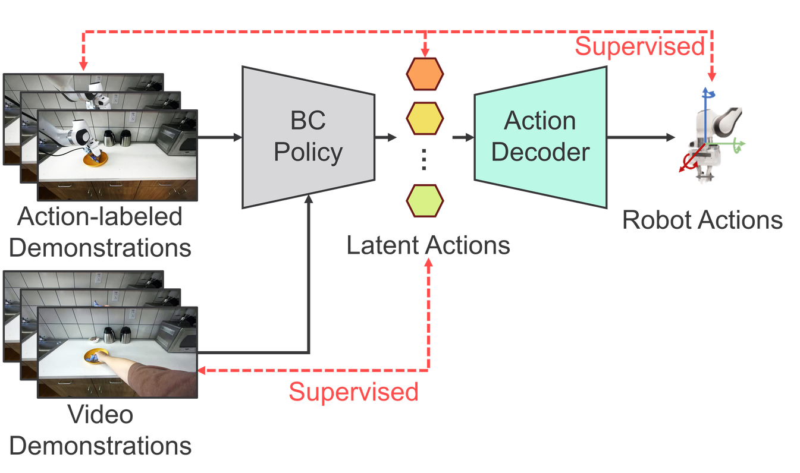
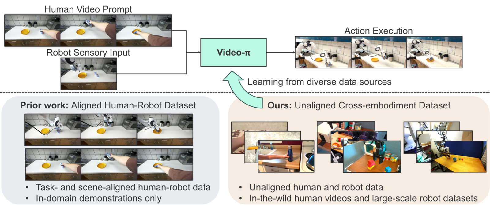
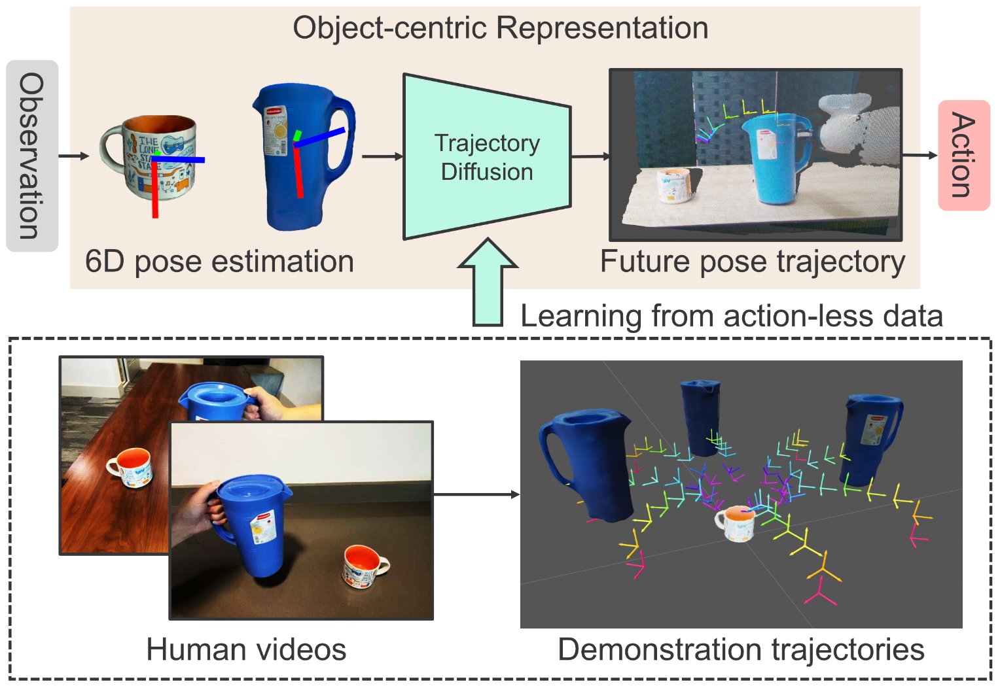
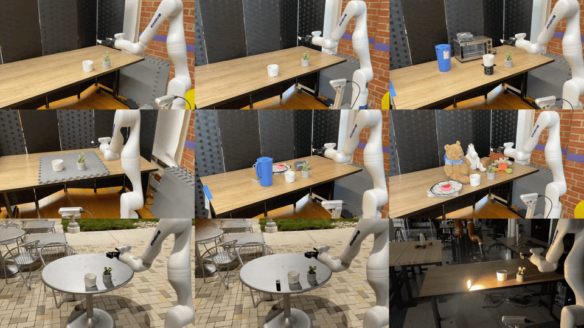
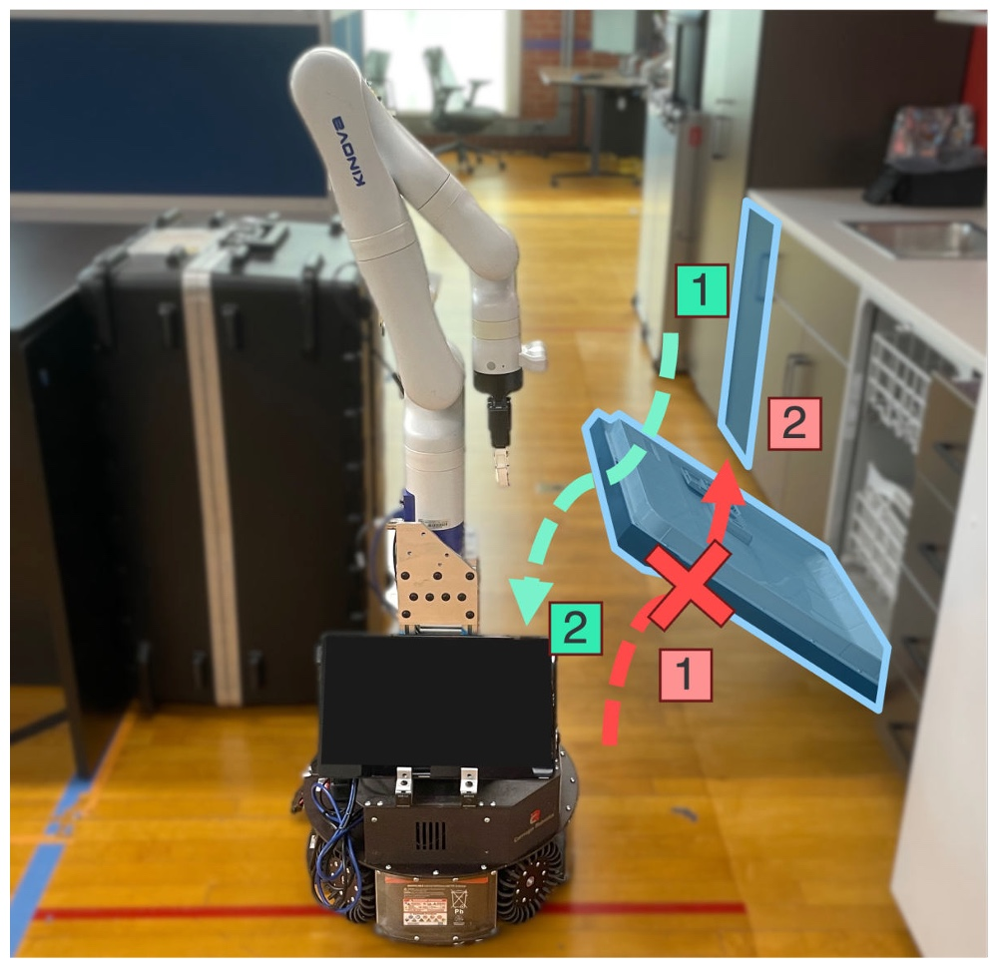
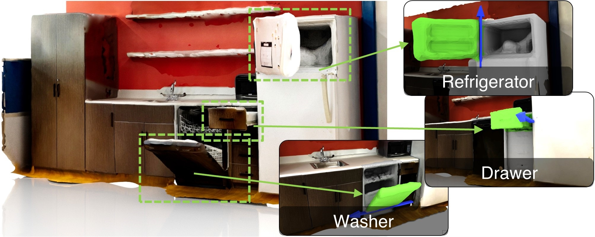
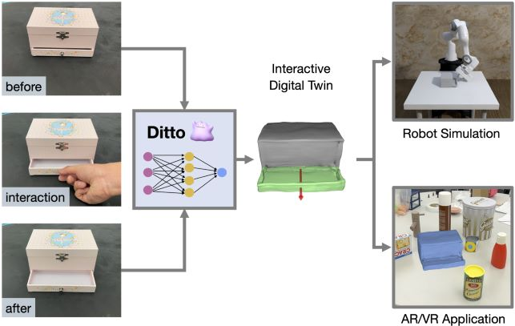
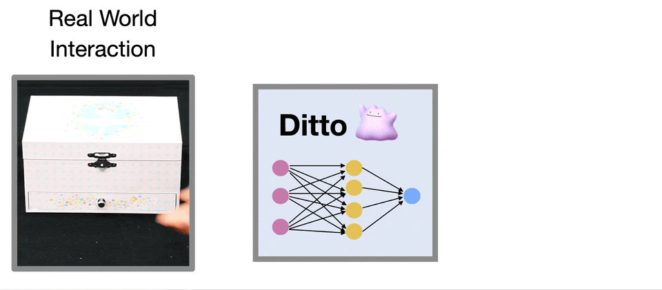

## About Me
I am a Ph.D. student in Computer Science at the <a href="https://www.cs.utexas.edu/">University of Texas at Austin</a>. I am advised by Prof. <a href="https://www.cs.utexas.edu/~pstone/">Peter Stone</a>. My research focuses on learning robot manipulation from scalable data sources such as human videos. I have also interned at NVIDIA Research, working with <a href="https://wenbowen123.github.io/">Bowen Wen</a> and <a href="https://sbirchfield.github.io/">Stan Birchfield</a>.

<!-- ## News -->

<h2 id="publications" style="margin: 2px 0px -15px;">Publications <temp style="font-size:15px;">[</temp><a href="https://scholar.google.com/citations?user=9rh0w2QAAAAJ" target="_blank" style="font-size:15px;">Google Scholar</a><temp style="font-size:15px;">]</temp></h2>

<ol class="bibliography">

<li>

  

    
  

  

      
<a href="https://end2end-latent-action.github.io/">ELA: End-to-End Latent Action Policy Learning from Video Demonstrations</a>

      
<u><strong>Cheng-Chun Hsu</strong></u>, Peter Stone

      
<em>Conference on Robot Learning <strong>(CoRL)</strong>, 2026.</em>
      

    

      <a href="https://end2end-latent-action.github.io/" class="btn btn-sm z-depth-0" role="button" target="_blank" style="font-size:12px;">Project Page</a>
      <a href="https://arxiv.org/abs/2611.05571" class="btn btn-sm z-depth-0" role="button" target="_blank" style="font-size:12px;">Paper</a>
    

     
    ELA learns robot policies from abundant action-free video plus only a handful of action-labeled demonstrations, by learning latent actions and the policy end-to-end.
     
  

</li>

 

<li>

  

    
  

  

      
Video-&pi;: Learning a Video-Conditioned Policy from Unaligned Human and Robot Data

      
Anonymous Authors

      
<em>In submission.</em>
      

     
    We learn a video-conditioned policy that lets robots perform tasks shown in human videos, trained from human and robot data that are not paired or aligned.
     
  

</li>

 

<li>

  

    <!--  -->
    
  

  

      
<a href="https://nvlabs.github.io/object_centric_diffusion/">SPOT: SE(3) Pose Trajectory Diffusion for Object-Centric Manipulation</a>

      
<u><strong>Cheng-Chun Hsu</strong></u>, Bowen Wen, Jie Xu, Yashraj Narang, Xiaolong Wang, Yuke Zhu, Joydeep Biswas, Stan Birchfield

      
<em>International Conference on Robotics and Automation <strong>(ICRA)</strong>, 2025.</em>
      

    

      <a href="https://nvlabs.github.io/object_centric_diffusion/" class="btn btn-sm z-depth-0" role="button" target="_blank" style="font-size:12px;">Project Page</a>
      <a href="https://arxiv.org/abs/2411.00965" class="btn btn-sm z-depth-0" role="button" target="_blank" style="font-size:12px;">Paper</a>
      <a href="https://github.com/NVlabs/object_centric_diffusion/tree/main" class="btn btn-sm z-depth-0" role="button" target="_blank" style="font-size:12px;">Code</a>
    

     
    We enable robots to learn everyday tasks from human video demonstrations by usinbg object-centric representation. By predicting future object pose trajectories, SPOT achieves strong generalization capabilities with only eight human video demonstrations.
     
  

</li>

 

<li>

  

    <!--  -->
    
  

  

      
<a href="https://chengchunhsu.github.io/KinScene/">KinScene: Model-Based Mobile Manipulation of Articulated Scenes</a>

      
<u><strong>Cheng-Chun Hsu</strong></u>, Ben Abbatematteo, Zhenyu Jiang, Yuke Zhu, Roberto Martín-Martín, Joydeep Biswas

      
<em></em>
      

      <!-- 
<em>A Future Roadmap for Sensorimotor Skill Learning Workshop</em>
      
 -->
      
<em>Mobile Manipulation Workshop at ICRA, 2024.</em>
      

      <strong><i style="color:#e74d3c">Spotlight Presentation</i></strong>
    

      <a href="https://chengchunhsu.github.io/KinScene/" class="btn btn-sm z-depth-0" role="button" target="_blank" style="font-size:12px;">Project Page</a>
      <a href="https://arxiv.org/abs/2409.16473" class="btn btn-sm z-depth-0" role="button" target="_blank" style="font-size:12px;">Paper</a>
    

     
    We enable mobile manipulators to perform long-horizon tasks by autonomously exploring and building scene-level articulation models of articulated objects. It maps the scene, infers object properties, and plans sequential interactions for accurate real-world manipulation.
     
  

</li>

 

<li>

  

    <!--  -->
    
  

  

      
<a href="https://ut-austin-rpl.github.io/HouseDitto/">Ditto in the House: Building Articulated Models of Indoor Scenes through Interactive Perception</a>

      
<u><strong>Cheng-Chun Hsu</strong></u>, Zhenyu Jiang, Yuke Zhu

      
<em>International Conference on Robotics and Automation <strong>(ICRA)</strong>, 2023.</em>
      

    

      <a href="https://ut-austin-rpl.github.io/HouseDitto/" class="btn btn-sm z-depth-0" role="button" target="_blank" style="font-size:12px;">Project Page</a>
      <a href="https://arxiv.org/abs/2302.01295" class="btn btn-sm z-depth-0" role="button" target="_blank" style="font-size:12px;">Paper</a>
      <a href="https://github.com/UT-Austin-RPL/HouseDitto" class="btn btn-sm z-depth-0" role="button" target="_blank" style="font-size:12px;">Code</a>
    

     
    We develop an interactive perception approach for robots to build indoor scene articulation models by efficiently discovering and characterizing articulated objects through coupled affordance prediction and articulation inference.
     
  

</li>

 

<li>

  

    <!--  -->
    
  

  <!-- 

    <video width=175px muted autoplay loop>
      <source src="./assets/data/teaser_cvpr22_ditto.mp4" type="video/mp4">
      Your browser does not support the video tag.
    </video>
  
 -->

  <!-- 

    

      <video width=175px outline:none muted autoplay loop>
        <source src="./assets/data/teaser_cvpr22_ditto.mp4" type="video/mp4">
        Your browser does not support the video tag.
      </video>
    

  
 -->

  

      
<a href="https://ut-austin-rpl.github.io/Ditto/">Ditto: Building Digital Twins of Articulated Objects from Interaction</a>

      
Zhenyu Jiang, <u><strong>Cheng-Chun Hsu</strong></u>, Yuke Zhu

      
<em>Computer Vision and Pattern Recognition <strong>(CVPR)</strong>, 2022.</em>
      

      <strong><i style="color:#e74d3c">Oral Presentation</i></strong>
    

      <a href="https://ut-austin-rpl.github.io/Ditto/" class="btn btn-sm z-depth-0" role="button" target="_blank" style="font-size:12px;">Project Page</a>
      <a href="https://arxiv.org/abs/2202.08227" class="btn btn-sm z-depth-0" role="button" target="_blank" style="font-size:12px;">Paper</a>
      <a href="https://github.com/UT-Austin-RPL/Ditto" class="btn btn-sm z-depth-0" role="button" target="_blank" style="font-size:12px;">Code</a>
    

     
    We develop an approach that builds digital twins of articulated objects by learning their articulation models and 3D geometry from visual observations before and after interaction.
     
  

</li>

</ol>

<!-- ## Services
Conference Reviewers: NeurIPS, ICLR, ECCV, WACV, AAAI, IJCAI -->